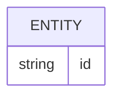

# Banco de dados

<!-- specsfy:documentator:start -->
## Fontes de persistência

| Arquivo |
| --- |
| apps\functions\src\database\migrations\0000_init.sql |
| apps\functions\src\database\migrations\meta\0000_snapshot.json |
| apps\functions\src\database\migrations\meta\_journal.json |
| apps\functions\src\database\MIGRATIONS.md |
| Nenhuma estrutura confirmada além das fontes listadas. |

<!-- specsfy:documentator:end -->
