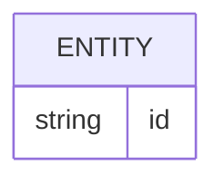

# Banco de dados

<!-- specsfy:documentator:start -->
## Persistence Sources

| File |
| --- |
| apps\functions\src\database\migrations\0000_init.sql |
| apps\functions\src\database\migrations\meta\0000_snapshot.json |
| apps\functions\src\database\migrations\meta\_journal.json |
| apps\functions\src\database\MIGRATIONS.md |
| layers\admin\migrations\0000_admin.sql |
| layers\admin\migrations\meta\0000_snapshot.json |
| layers\admin\migrations\meta\_journal.json |
| layers\billing\migrations\0000_billing.sql |
| layers\billing\migrations\meta\0000_snapshot.json |
| layers\billing\migrations\meta\_journal.json |
| layers\kanban\migrations\0000_kanban.sql |
| layers\kanban\migrations\meta\0000_snapshot.json |
| layers\kanban\migrations\meta\_journal.json |
| layers\notifications\migrations\0000_notifications.sql |
| layers\notifications\migrations\meta\0000_snapshot.json |
| layers\notifications\migrations\meta\_journal.json |
| layers\teams\migrations\0000_teams.sql |
| layers\teams\migrations\meta\0000_snapshot.json |
| layers\teams\migrations\meta\_journal.json |
| scripts\print-migration-bootstrap.mjs |
| scripts\print-migration-bootstrap.test.ts |
| scripts\run-migrations.mjs |
| specs\review\0005-desacoplar-billing-da-base-team-sem-plan-obrigatorio-e-migrations-por-base-feature\spec.md |
| specs\review\0006-migrations-base-feature-historicos-independentes\spec.md |
| No confirmed structure beyond listed sources. |

<!-- specsfy:documentator:end -->
