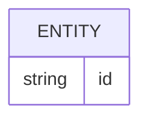

# Banco de dados

## Política de mudança no banco (regra absoluta, decisão do dono, 2026-09-30)

- Cada história de migração é isolada: a base (`apps/functions`) só tem o que faz login e a plataforma funcionarem; cada layer com tabelas tem a sua (`layers/<nome>/migrations/`) e é ligada ou desligada em `config.ts`. Layer desligada nunca sobe tabela.
- Uma capacidade nova é um passo específico, bem definido e direto: layer e história próprias (ou a história da layer dona), só com o que ela precisa, inclusive extensões do Postgres.
- **Ajuste edita o init da história dona e o banco é resetado e sobe de novo zerado** (comando de reset protegido e, em seguida, `bun run deploy`). É sempre o padrão até o lançamento da aplicação: sem migrações de remendo, sem cadeias de `ALTER`, sem expand/contract, sem scripts de bootstrap.
- Um novo init numerado (`001_init.sql`) só quando a aplicação subir de versão (V02).
- Agentes editam o init e o código, mas nunca rodam comando destrutivo; o reset é de quem responde pelo projeto. O reset não faz parte do `bun run deploy`, que só aplica migrações e seed (auditoria de 2026-09-30). Ele é um comando à parte e protegido (`bun run db:reset`, especificado na SPEC-0007); até existir, vale o reset manual descrito em `.fireskills/RULES.md`.
- Texto completo: `.fireskills/RULES.md`.

<!-- specsfy:documentator:start -->
## Persistence Sources

| File |
| --- |
| apps\functions\src\database\migrations\0000_init.sql |
| apps\functions\src\database\migrations\meta\0000_snapshot.json |
| apps\functions\src\database\migrations\meta\_journal.json |
| apps\functions\src\database\MIGRATIONS.md |
| layers\account\migrations\0000_account.sql |
| layers\account\migrations\meta\0000_snapshot.json |
| layers\account\migrations\meta\_journal.json |
| layers\admin\migrations\0000_admin.sql |
| layers\admin\migrations\meta\0000_snapshot.json |
| layers\admin\migrations\meta\_journal.json |
| layers\billing\migrations\0000_billing.sql |
| layers\billing\migrations\meta\0000_snapshot.json |
| layers\billing\migrations\meta\_journal.json |
| layers\kanban\migrations\0000_kanban.sql |
| layers\kanban\migrations\meta\0000_snapshot.json |
| layers\kanban\migrations\meta\_journal.json |
| layers\notifications\migrations\0000_notifications.sql |
| layers\notifications\migrations\meta\0000_snapshot.json |
| layers\notifications\migrations\meta\_journal.json |
| layers\teams\migrations\0000_teams.sql |
| layers\teams\migrations\meta\0000_snapshot.json |
| layers\teams\migrations\meta\_journal.json |
| scripts\print-migration-bootstrap.mjs |
| scripts\print-migration-bootstrap.test.ts |
| scripts\run-migrations.mjs |
| No confirmed structure beyond listed sources. |

<!-- specsfy:documentator:end -->
