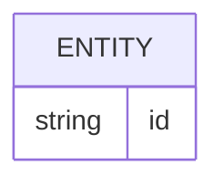

# Banco de dados

<!-- specsfy:documentator:start -->
## Persistence Sources

| File |
| --- |
| apps/functions/src/database/MIGRATIONS.md |
| apps/functions/src/database/migrations/0000_init.sql |
| apps/functions/src/database/migrations/0001_pending_purchase.sql |
| apps/functions/src/database/migrations/meta/0000_snapshot.json |
| apps/functions/src/database/migrations/meta/0001_snapshot.json |
| apps/functions/src/database/migrations/meta/_journal.json |
| No confirmed structure beyond listed sources. |

<!-- specsfy:documentator:end -->
